<picture>
  <source media="(prefers-color-scheme: dark)" srcset="./dark.svg">
  <source media="(prefers-color-scheme: light)" srcset="./light.svg">
  
</picture>

## 👋 Hi, I'm Yaashini

I'm a **B.Tech Information Technology student** at Sri Krishna College of Engineering and Technology (2023–2027, CGPA 8.0) based in **Coimbatore, Tamil Nadu**.

I build full-stack applications end to end, from **Figma prototypes** to **deployed production apps**, using React.js, Java Spring Boot, Firebase and MySQL. I'm currently looking for a software development role where I can build scalable, user-centric solutions in a collaborative team.

---

## 🎯 Focus

- **Full-stack development**: React.js frontends with Spring Boot / Firebase backends
- **UI/UX design**: wireframes and prototypes in Figma, Adobe XD and Canva
- **Data analytics**: Power BI and Python (Pandas, NumPy)
- **Engineering practice**: REST API design, Git feature-branch workflow, iterative SDLC

---

## 🚀 Featured Projects

### [Online Quiz Tracker](https://github.com/yaashinisekar/OnlineQuizTracker)

`React.js` `Firebase` `JavaScript` `REST APIs` `HTML5` `CSS3` `Git`

A full-stack quiz platform with Firebase Authentication and role-based access for admin and user flows.

- Timed quiz engine with auto-submit and an instant correct/incorrect score breakdown
- Firestore schema for dynamic question management, with a real-time add/edit/delete admin panel
- Reusable React components for quiz state, timer logic and automated scoring
- Fully responsive UI across devices

### [Smart Expense Tracker](https://github.com/yaashinisekar/SmartExpenseTracker)

`Java` `Spring Boot` `React.js` `MySQL` `Tailwind CSS` `JWT` `REST APIs`

A secure finance app where users record, categorise and monitor expenses and income.

- JWT authentication with automated budget-cap threshold alerts
- Interactive analytics dashboard with charts for spending patterns and income trends
- Spring Boot CRUD APIs with input validation and normalised MySQL schemas
- Figma wireframes and API contracts defined before coding to reduce rework

---

## 🛠️ Engineering Stack

| Area | Technologies |
|---|---|
| **Frontend** | React.js, JavaScript (ES6+), HTML5, CSS3, Tailwind CSS |
| **Backend** | Java, Spring Boot (REST APIs, Microservices, JPA), JWT Authentication, Firebase Auth |
| **Databases** | MySQL, Firebase Firestore |
| **Design & Analytics** | Figma, Adobe XD, Canva, Power BI, Python (Pandas, NumPy) |
| **Tools** | Git & GitHub, VS Code, RESTful API design |

---

## 🎓 Education & Certifications

**B.Tech, Information Technology**, Sri Krishna College of Engineering and Technology (2023–2027), CGPA 8.0 (ongoing)

- UI/UX Design & Frontend Development (Udemy)
- REST API & Spring Boot (Infosys)
- Java Essentials (HackerRank)

---

## 🏆 Activities

- **Smart India Hackathon, Internal Qualifying Rounds, SKCET** (Aug 2024 & Oct 2025): competed in two consecutive years, building and presenting technology-driven solutions in teams under tight time limits.
- **Empower Tech Technical Expo, VIT** (March 2025): presented a full-stack web project to industry professionals and faculty.

---

## 📊 GitHub Activity

---

## 🤝 Connect

<!--
**yaashinisekar/yaashinisekar** is a ✨ _special_ ✨ repository because its `README.md` (this file) appears on your GitHub profile.
-->
